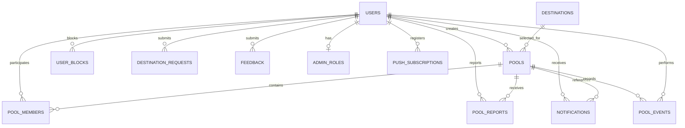

# 04 — Database Design

**Project:** ShareKar  
**Document:** Database Design  
**Version:** 1.0 — Draft for Review  
**Product stage:** V1 — Local MVP  
**Database:** PostgreSQL  
**ORM:** Prisma  
**Backend:** Node.js + Express.js + TypeScript  
**Status:** Pending approval

---

## 1. Purpose

This document defines the proposed relational database structure for ShareKar V1.

It covers:

- Database entities and relationships
- Table structures and column definitions
- Data types and constraints
- Indexing strategy
- Referential integrity
- Pool membership and lifecycle consistency
- Transaction requirements
- Security and access considerations
- Prisma implementation guidance

The database is designed around the approved V1 Product Requirements Document and the planned Business Rules.

## 2. Database design principles

The database follows these principles:

1. PostgreSQL is the source of truth for persistent application data.
2. Prisma is used for database access and schema management.
3. UUIDs are used as primary keys.
4. Timestamps are stored in UTC using `TIMESTAMPTZ`.
5. Important business constraints are enforced at database level wherever possible.
6. Historical records are retained instead of deleting important operational data.
7. Pool lifecycle events are recorded for auditing.
8. Sensitive authentication data is never exposed through public API responses.
9. Database transactions are used for operations involving capacity, membership, and pool state.
10. The schema should remain modular and extensible without introducing unnecessary infrastructure.

## 3. Database overview

The design contains **12 tables**.

### 3.1 Core tables

| No. | Table | Purpose |
|---|---|---|
| 1 | `users` | User profiles and authentication fields |
| 2 | `destinations` | Administrator-managed destinations |
| 3 | `pools` | Pool creation and lifecycle information |
| 4 | `pool_members` | Pool membership and participation history |
| 5 | `pool_reports` | Reports against users or pools |
| 6 | `user_blocks` | User blocking relationships |
| 7 | `notifications` | In-app notifications |
| 8 | `pool_events` | Append-only pool activity history |

### 3.2 Supporting tables

| No. | Table | Purpose |
|---|---|---|
| 9 | `destination_requests` | User requests for missing destinations |
| 10 | `feedback` | Suggestions, technical problems, and experience feedback |
| 11 | `admin_roles` | Administrator authorization |
| 12 | `push_subscriptions` | Registered devices and push notification subscriptions |

Authentication remains directly in `users`, as decided. No separate authentication identity table is planned for V1.

---

## 4. Entity relationship overview



The diagram shows the main relationships. Optional relationships, such as a report referring to a pool or reported user, may be nullable.

---

# 5. Table definitions

## 5.1 `users`

**Purpose:** Stores user profile, authentication, account status, and verification information.

| Column | PostgreSQL type | Constraints | Description |
|---|---|---|---|
| `id` | UUID | Primary key | Unique user identifier |
| `full_name` | VARCHAR(120) | NOT NULL | User's full name |
| `email` | VARCHAR(255) | NOT NULL, UNIQUE | User email |
| `phone` | VARCHAR(20) | NOT NULL, UNIQUE | Phone number in normalized international format |
| `phone_verified_at` | TIMESTAMPTZ | NULL | Phone verification timestamp |
| `gender` | ENUM | NOT NULL | MALE, FEMALE, OTHER |
| `profile_image_url` | TEXT | NOT NULL | Profile image location |
| `password_hash` | TEXT | NULL | Password hash, if password authentication is supported |
| `google_subject` | VARCHAR(255) | UNIQUE, NULL | Google identity subject |
| `account_status` | ENUM | NOT NULL | ACTIVE, SUSPENDED, DEACTIVATED |
| `token_version` | INTEGER | NOT NULL, DEFAULT 0 | Used to invalidate previously issued tokens |
| `created_at` | TIMESTAMPTZ | NOT NULL | Account creation time |
| `updated_at` | TIMESTAMPTZ | NOT NULL | Last profile update |

**Important rules:**

- Phone and email must be unique.
- Phone verification is required before creating or joining pools.
- `password_hash` and `google_subject` must never be returned in normal API responses.
- At least one supported authentication method must be available.
- OTP codes should not be stored as plaintext in this table.
- `token_version` should be incremented when an account is suspended, deactivated, or otherwise requires token invalidation.
- Account status is controlled by the backend and authorized administrators.
- `women_pool_eligible` does not need to be stored separately in V1. It can be derived from `gender = FEMALE`, provided the backend applies the same rule consistently.

**Authentication note:** Google login alone does not satisfy phone verification. The user must still complete SMS OTP verification.

## 5.2 `destinations`

**Purpose:** Stores destinations available for pool creation and discovery.

| Column | PostgreSQL type | Constraints | Description |
|---|---|---|---|
| `id` | UUID | Primary key | Destination identifier |
| `name` | VARCHAR(150) | NOT NULL | Destination name |
| `address` | TEXT | NOT NULL | Full destination address |
| `latitude` | DOUBLE PRECISION | NOT NULL | Latitude |
| `longitude` | DOUBLE PRECISION | NOT NULL | Longitude |
| `is_active` | BOOLEAN | NOT NULL, DEFAULT TRUE | Whether users can select the destination |
| `created_at` | TIMESTAMPTZ | NOT NULL | Creation time |
| `updated_at` | TIMESTAMPTZ | NOT NULL | Last update |

**Important rules:**

- Only administrators can add or modify destination records.
- Users can select only active destinations.
- Users cannot create arbitrary destinations.
- Destination records should be deactivated instead of deleted when referenced by historical pools.
- Coordinates must be within valid geographic ranges.

## 5.3 `pools`

**Purpose:** Stores pool configuration, pickup, destination, timing, capacity, and lifecycle information.

| Column | PostgreSQL type | Constraints | Description |
|---|---|---|---|
| `id` | UUID | Primary key | Pool identifier |
| `creator_id` | UUID | FK → users.id, NOT NULL | Pool creator |
| `destination_id` | UUID | FK → destinations.id, NOT NULL | Selected destination |
| `visibility` | ENUM | NOT NULL | GENERAL, WOMEN_ONLY |
| `journey_type` | ENUM | NOT NULL | IMMEDIATE, SCHEDULED |
| `pickup_address` | TEXT | NOT NULL | Selected pickup address |
| `pickup_latitude` | DOUBLE PRECISION | NOT NULL | Pickup latitude |
| `pickup_longitude` | DOUBLE PRECISION | NOT NULL | Pickup longitude |
| `departure_time` | TIMESTAMPTZ | NOT NULL | Expected departure time |
| `join_deadline` | TIMESTAMPTZ | NOT NULL | Latest joining time |
| `capacity` | SMALLINT | NOT NULL | Maximum total passengers, including creator |
| `status` | ENUM | NOT NULL | OPEN, READY, EXPIRED, CANCELLED |
| `locked_at` | TIMESTAMPTZ | NULL | Time pickup/departure/capacity became locked |
| `ready_at` | TIMESTAMPTZ | NULL | Time pool became Ready |
| `closed_at` | TIMESTAMPTZ | NULL | Time pool stopped being active |
| `cancelled_by` | UUID | FK → users.id, NULL | User/admin responsible for cancellation |
| `cancelled_at` | TIMESTAMPTZ | NULL | Cancellation time |
| `cancellation_reason` | TEXT | NULL | Optional cancellation reason |
| `expiration_reason` | ENUM | NULL | DEADLINE_REACHED, DEPARTURE_REACHED, READY_TIMEOUT |
| `created_at` | TIMESTAMPTZ | NOT NULL | Pool creation time |
| `updated_at` | TIMESTAMPTZ | NOT NULL | Last update |

**Important rules:**

- `capacity` must be between 1 and 3.
- Creator is automatically inserted into `pool_members`.
- `destination_id` must refer to an active destination when creating a pool.
- `join_deadline` must be in the future at creation.
- For scheduled pools, joining deadline must be before departure time.
- Pickup and departure time become locked when the first additional passenger joins.
- Capacity becomes locked at the same point.
- Joining deadline may be extended while the pool is Open, subject to the Business Rules.
- Pool status transitions must be validated by the backend.
- A Ready pool automatically closes after 30 minutes.
- A Ready pool that reaches its auto-close threshold is represented as `EXPIRED` with `expiration_reason = READY_TIMEOUT`. The event history preserves the earlier Ready state.
- Cancelled pools retain their historical information.

**Capacity interpretation for V1:**

The selected capacity is the maximum number of passengers, not a required target. The minimum active membership count for a pool to become Ready at its deadline is one. Thus:

- Capacity 1: becomes Ready immediately.
- Capacity 2: may become Ready with one or two active members at the deadline.
- Capacity 3: may become Ready with one, two, or three active members at the deadline.

This interpretation follows the currently confirmed pool lifecycle rules.

## 5.4 `pool_members`

**Purpose:** Tracks users participating in pools, including historical participation.

| Column | PostgreSQL type | Constraints | Description |
|---|---|---|---|
| `id` | UUID | Primary key | Membership identifier |
| `pool_id` | UUID | FK → pools.id, NOT NULL | Associated pool |
| `user_id` | UUID | FK → users.id, NOT NULL | Participating user |
| `member_status` | ENUM | NOT NULL | ACTIVE, LEFT, REMOVED |
| `joined_at` | TIMESTAMPTZ | NOT NULL | Joining time |
| `left_at` | TIMESTAMPTZ | NULL | Time membership ended |
| `ended_reason` | VARCHAR(100) | NULL | Optional reason for membership ending |
| `created_at` | TIMESTAMPTZ | NOT NULL | Record creation time |

**Important rules:**

- Pool creator is automatically added as an ACTIVE member.
- A user cannot have two ACTIVE memberships in the same pool.
- A user cannot have ACTIVE memberships in multiple pools.
- Leaving a pool changes membership status; it does not delete the record.
- Rejoining creates a new membership row.
- Removing a passenger through an authorized admin action changes their membership status to REMOVED.
- Historical membership rows are retained.

**Database constraints:**

Two partial unique indexes are required:

1. One ACTIVE membership per user per pool.
2. One ACTIVE membership per user across all pools.

The second index enforces the one-active-pool restriction.

These partial unique indexes should be added through a custom PostgreSQL migration. They may not be fully represented by the Prisma schema's standard unique constraints, depending on the Prisma version and feature support.

## 5.5 `pool_reports`

**Purpose:** Stores user reports against other users or pools.

| Column | PostgreSQL type | Constraints | Description |
|---|---|---|---|
| `id` | UUID | Primary key | Report identifier |
| `reporter_id` | UUID | FK → users.id, NOT NULL | Reporting user |
| `reported_user_id` | UUID | FK → users.id, NULL | Reported user |
| `pool_id` | UUID | FK → pools.id, NULL | Related pool |
| `reason` | VARCHAR(100) | NOT NULL | Report category |
| `description` | TEXT | NULL | Additional explanation |
| `status` | ENUM | NOT NULL | PENDING, REVIEWED, RESOLVED |
| `reviewed_by` | UUID | FK → users.id, NULL | Reviewing administrator |
| `reviewed_at` | TIMESTAMPTZ | NULL | Review timestamp |
| `created_at` | TIMESTAMPTZ | NOT NULL | Submission time |
| `updated_at` | TIMESTAMPTZ | NOT NULL | Last update |

**Important rules:**

- A report must refer to a user, a pool, or both.
- Reporter cannot report themselves as a user.
- Reports do not automatically suspend or remove users.
- Only authorized administrators can update report review status.
- Reports are retained for moderation and audit purposes.

## 5.6 `user_blocks`

**Purpose:** Stores directed blocking relationships between users.

| Column | PostgreSQL type | Constraints | Description |
|---|---|---|---|
| `id` | UUID | Primary key | Block identifier |
| `blocker_id` | UUID | FK → users.id, NOT NULL | User who blocks |
| `blocked_id` | UUID | FK → users.id, NOT NULL | User being blocked |
| `created_at` | TIMESTAMPTZ | NOT NULL | Block creation time |

**Important rules:**

- A user cannot block themselves.
- A blocker can block a particular user only once.
- Blocking is directional.
- If either user blocks the other, they must not be allowed to discover or join each other's future pools.
- Existing shared pool membership is not automatically modified by blocking.

**Unique constraint:** `(blocker_id, blocked_id)`.

## 5.7 `notifications`

**Purpose:** Stores in-app notifications.

| Column | PostgreSQL type | Constraints | Description |
|---|---|---|---|
| `id` | UUID | Primary key | Notification identifier |
| `user_id` | UUID | FK → users.id, NOT NULL | Notification recipient |
| `pool_id` | UUID | FK → pools.id, NULL | Related pool |
| `type` | ENUM | NOT NULL | Notification event type |
| `title` | VARCHAR(150) | NOT NULL | Notification title |
| `message` | TEXT | NOT NULL | Notification message |
| `is_read` | BOOLEAN | NOT NULL, DEFAULT FALSE | Read status |
| `created_at` | TIMESTAMPTZ | NOT NULL | Creation time |
| `read_at` | TIMESTAMPTZ | NULL | Read timestamp |

**Initial notification types:**

- MEMBER_JOINED
- MEMBER_LEFT
- POOL_READY
- POOL_EXPIRED
- POOL_CANCELLED
- DEPARTURE_REMINDER_10_MIN
- DEPARTURE_REMINDER_5_MIN
- ADMIN_ACTION

**Important rules:**

- Notifications are created for relevant affected users.
- In-app notification creation should be durable.
- Push delivery failure must not undo the underlying pool operation.
- Notifications for users who leave or are removed must not include future departure reminders.
- Scheduled reminder processing must avoid duplicate notifications.

## 5.8 `pool_events`

**Purpose:** Provides an append-only history of important pool operations.

| Column | PostgreSQL type | Constraints | Description |
|---|---|---|---|
| `id` | UUID | Primary key | Event identifier |
| `pool_id` | UUID | FK → pools.id, NOT NULL | Associated pool |
| `user_id` | UUID | FK → users.id, NULL | User responsible for event, if applicable |
| `event_type` | ENUM | NOT NULL | Event category |
| `metadata` | JSONB | NULL | Additional event information |
| `created_at` | TIMESTAMPTZ | NOT NULL | Event timestamp |

**Initial event types:**

- POOL_CREATED
- MEMBER_JOINED
- MEMBER_LEFT
- MEMBER_REMOVED
- PICKUP_UPDATED
- DEPARTURE_UPDATED
- CAPACITY_LOCKED
- DEADLINE_EXTENDED
- POOL_READY
- POOL_EXPIRED
- POOL_CANCELLED
- ADMIN_ACTION

**Important rules:**

- Events are append-only for ordinary users.
- Event metadata can store details such as previous and new deadline, cancellation reason, or administrative action.
- Pool lifecycle transitions should generate corresponding events.
- Events must not be used as a replacement for current pool state; `pools.status` remains the current source of truth.
- Events support auditability and debugging.

## 5.9 `destination_requests`

**Purpose:** Stores user requests for destinations not currently available in the directory.

| Column | PostgreSQL type | Constraints | Description |
|---|---|---|---|
| `id` | UUID | Primary key | Request identifier |
| `user_id` | UUID | FK → users.id, NOT NULL | Requesting user |
| `destination_name` | VARCHAR(150) | NOT NULL | Requested destination |
| `address` | TEXT | NULL | Suggested address |
| `latitude` | DOUBLE PRECISION | NULL | Suggested latitude |
| `longitude` | DOUBLE PRECISION | NULL | Suggested longitude |
| `description` | TEXT | NULL | Additional information |
| `status` | ENUM | NOT NULL | PENDING, APPROVED, REJECTED |
| `reviewed_by` | UUID | FK → users.id, NULL | Reviewing administrator |
| `destination_id` | UUID | FK → destinations.id, NULL | Destination created if approved |
| `reviewed_at` | TIMESTAMPTZ | NULL | Review time |
| `created_at` | TIMESTAMPTZ | NOT NULL | Request time |

**Important rules:**

- Users can submit requests but cannot directly add destinations.
- Only administrators can approve or reject requests.
- Approval may create a destination record.
- The approved destination ID is stored for reference.

## 5.10 `feedback`

**Purpose:** Stores user feedback and suggestions.

| Column | PostgreSQL type | Constraints | Description |
|---|---|---|---|
| `id` | UUID | Primary key | Feedback identifier |
| `user_id` | UUID | FK → users.id, NOT NULL | Submitting user |
| `pool_id` | UUID | FK → pools.id, NULL | Related pool, if applicable |
| `category` | ENUM | NOT NULL | SUGGESTION, TECHNICAL_PROBLEM, EXPERIENCE |
| `message` | TEXT | NOT NULL | Feedback content |
| `status` | ENUM | NOT NULL | PENDING, REVIEWED, RESOLVED |
| `reviewed_by` | UUID | FK → users.id, NULL | Reviewing administrator |
| `reviewed_at` | TIMESTAMPTZ | NULL | Review time |
| `created_at` | TIMESTAMPTZ | NOT NULL | Submission time |

**Important rules:**

- Users can submit feedback through the application.
- Administrators can review and update feedback status.
- Feedback does not use star ratings in V1.
- Feedback history should be retained.

## 5.11 `admin_roles`

**Purpose:** Defines administrator permissions separately from ordinary user profiles.

| Column | PostgreSQL type | Constraints | Description |
|---|---|---|---|
| `id` | UUID | Primary key | Role record identifier |
| `user_id` | UUID | FK → users.id, UNIQUE, NOT NULL | Administrator account |
| `role` | ENUM | NOT NULL | SUPER_ADMIN, ADMIN, MODERATOR |
| `granted_by` | UUID | FK → users.id, NULL | User who granted access |
| `created_at` | TIMESTAMPTZ | NOT NULL | Role creation time |
| `updated_at` | TIMESTAMPTZ | NOT NULL | Last update |

**Initial role definitions:**

- SUPER_ADMIN: Full administrative access.
- ADMIN: User, destination, pool, and report management.
- MODERATOR: Report review and permitted moderation actions.

The exact permission matrix must be implemented in backend authorization middleware.

Ordinary users must not be able to create or modify their own administrator roles.

## 5.12 `push_subscriptions`

**Purpose:** Stores push notification subscriptions for supported devices.

| Column | PostgreSQL type | Constraints | Description |
|---|---|---|---|
| `id` | UUID | Primary key | Subscription identifier |
| `user_id` | UUID | FK → users.id, NOT NULL | Subscription owner |
| `provider` | ENUM | NOT NULL | FCM, WEB_PUSH |
| `device_token` | TEXT | NOT NULL | Device token or subscription identifier |
| `device_type` | ENUM | NOT NULL | ANDROID, IOS, WEB |
| `is_active` | BOOLEAN | NOT NULL, DEFAULT TRUE | Subscription status |
| `last_used_at` | TIMESTAMPTZ | NULL | Last successful use |
| `created_at` | TIMESTAMPTZ | NOT NULL | Registration time |
| `updated_at` | TIMESTAMPTZ | NOT NULL | Last update |

**Important rules:**

- One user may register multiple devices.
- A device token must not be duplicated for the same provider.
- Invalid or expired tokens should be deactivated.
- Push subscriptions are optional; in-app notifications remain available.
- Push tokens must not be exposed in ordinary user profile responses.

---

# 6. Relationship and deletion strategy

| Relationship | Type | Behaviour |
|---|---|---|
| User → Pools | One-to-many | Creator reference retained |
| Destination → Pools | One-to-many | Restrict deletion when referenced |
| Pool → Pool members | One-to-many | Retain historical memberships |
| User → Pool members | One-to-many | Retain participation history |
| User → Reports | One-to-many | Retain moderation history |
| User → Blocks | One-to-many | Retain until unblocked |
| User → Notifications | One-to-many | Retain according to notification policy |
| Pool → Events | One-to-many | Retain audit history |
| User → Feedback | One-to-many | Retain feedback records |
| User → Admin role | One-to-one | Remove or revoke role through authorized action |
| User → Push subscriptions | One-to-many | Deactivate or delete invalid subscriptions |

**Deletion policy:**

Avoid cascading deletion of important pool, report, event, and membership records.

Account deletion should follow the application's retention and anonymization policy. The user profile may be anonymized after the retention period while preserving required operational and audit records.

---

# 7. Indexing strategy

Indexes are required for frequently queried columns and relationships.

| Table | Index | Purpose |
|---|---|---|
| `users` | UNIQUE(phone) | Phone login and uniqueness |
| `users` | UNIQUE(email) | Email uniqueness |
| `users` | INDEX(account_status) | Account status checks |
| `destinations` | INDEX(is_active, name) | Active destination search |
| `pools` | INDEX(destination_id, status, departure_time) | Pool discovery |
| `pools` | INDEX(status, join_deadline) | Deadline processing |
| `pools` | INDEX(creator_id, created_at) | Creator history |
| `pool_members` | INDEX(pool_id, member_status) | Active pool membership |
| `pool_members` | INDEX(user_id, joined_at) | User participation history |
| `pool_reports` | INDEX(status, created_at) | Admin report queue |
| `user_blocks` | UNIQUE(blocker_id, blocked_id) | Duplicate block prevention |
| `notifications` | INDEX(user_id, is_read, created_at) | Notification retrieval |
| `pool_events` | INDEX(pool_id, created_at) | Pool event history |
| `destination_requests` | INDEX(status, created_at) | Destination request review |
| `feedback` | INDEX(status, created_at) | Feedback review |
| `admin_roles` | UNIQUE(user_id) | Administrator lookup |
| `push_subscriptions` | INDEX(user_id, is_active) | Active device lookup |

Additional indexes should be introduced only when query patterns justify them.

## 8. Critical database constraints

The following constraints are especially important.

### 8.1 Capacity validation

```sql
CHECK (capacity >= 1 AND capacity <= 3)
```

### 8.2 Coordinate validation

Latitude:

```sql
CHECK (pickup_latitude BETWEEN -90 AND 90)
```

Longitude:

```sql
CHECK (pickup_longitude BETWEEN -180 AND 180)
```

Apply equivalent checks to destination coordinates.

### 8.3 One active membership per pool and user

```sql
CREATE UNIQUE INDEX one_active_membership_per_pool_user
ON pool_members (pool_id, user_id)
WHERE member_status = 'ACTIVE';
```

### 8.4 One active pool per user

```sql
CREATE UNIQUE INDEX one_active_pool_per_user
ON pool_members (user_id)
WHERE member_status = 'ACTIVE';
```

These partial unique indexes are critical to enforcing the one-active-pool rule.

### 8.5 No self-blocking

```sql
CHECK (blocker_id <> blocked_id)
```

### 8.6 Report target validation

A report must reference at least one target:

```sql
CHECK (reported_user_id IS NOT NULL OR pool_id IS NOT NULL)
```

Additional application validation must prevent users from reporting themselves.

### 8.7 Scheduled deadline validation

For scheduled pools:

```text
join_deadline < departure_time
```

This is a cross-column rule that can be enforced using a database check constraint conditioned on `journey_type`, and also validated by the backend.

---

# 9. Transaction and concurrency requirements

Some operations affect multiple records and must execute inside database transactions.

## 9.1 Creating a pool

A pool creation transaction must:

1. Validate user account status.
2. Validate phone verification.
3. Validate profile completeness.
4. Check that the user has no active pool membership.
5. Validate destination availability.
6. Validate capacity and timing.
7. Create the pool.
8. Create the creator's ACTIVE membership.
9. Create a POOL_CREATED event.
10. Commit the transaction.

If any required step fails, the transaction must roll back.

## 9.2 Joining a pool

A joining transaction must:

1. Lock the pool row or otherwise serialize competing capacity updates.
2. Validate pool status.
3. Validate joining deadline and departure time.
4. Validate capacity.
5. Validate account and pool eligibility.
6. Validate user active-pool restrictions.
7. Validate blocking relationships.
8. Insert an ACTIVE membership.
9. If this is the first additional member, set `locked_at`.
10. Create a MEMBER_JOINED event.
11. Create notifications for affected users.
12. Commit the transaction.

The pool row should be locked using an appropriate PostgreSQL transaction strategy, such as `SELECT ... FOR UPDATE`, to prevent two users from taking the same last seat.

The partial unique index on active membership provides an additional database-level safeguard.

## 9.3 Leaving a pool

A leaving transaction must:

1. Verify that the user is an ACTIVE member.
2. Verify that the pool is Open.
3. Update membership status to LEFT.
4. Set `left_at`.
5. Create a MEMBER_LEFT event.
6. Notify relevant members.
7. Commit the transaction.

If the creator leaves an Open pool, the system must cancel the entire pool instead.

## 9.4 Cancelling a pool

A cancellation transaction must:

1. Verify creator or authorized admin permission.
2. Verify that the pool can be cancelled.
3. Update pool status to CANCELLED.
4. Set cancellation metadata.
5. Create a POOL_CANCELLED event.
6. Create notifications for affected members.
7. Ensure scheduled reminders are no longer eligible for delivery.
8. Commit the transaction.

## 9.5 Extending a deadline

A deadline extension transaction must:

1. Verify the user is the creator.
2. Verify pool status is Open.
3. Validate the new deadline is later than the current deadline.
4. Validate the new deadline is in the future.
5. For scheduled pools, validate it remains before departure.
6. Update `join_deadline`.
7. Create a DEADLINE_EXTENDED event.
8. Commit the transaction.

---

# 10. Pool lifecycle and database consistency

The `pools` table stores the current state. The `pool_events` table stores the historical sequence of actions.

The application must not infer current pool status only by reading event history.

### Lifecycle representation

| Event | `pools.status` | Additional data |
|---|---|---|
| Pool created | OPEN | `created_at` |
| Capacity 1 created | READY | `ready_at` |
| Joining deadline reached with active member | READY | `ready_at` |
| Joining deadline reached with no active members | EXPIRED | `expiration_reason = DEADLINE_REACHED` |
| Departure reached with active member | READY | `ready_at` |
| Departure reached with no active members | EXPIRED | `expiration_reason = DEPARTURE_REACHED` |
| Creator cancels | CANCELLED | Cancellation fields |
| Ready pool auto-closes | EXPIRED | `expiration_reason = READY_TIMEOUT` |

The Ready-to-Expired transition preserves the fact that the pool was Ready through the event history.

---

# 11. Authentication and token invalidation

V1 stores authentication-related fields directly in `users`.

Recommended approach:

- Store password hashes, never plaintext passwords.
- Store the Google identity subject when Google authentication is enabled.
- Use the SMS provider to verify phone numbers.
- Store the verification timestamp in `phone_verified_at`.
- Issue signed access tokens.
- Use secure refresh-token handling if refresh tokens are implemented.
- Validate account status on protected operations.

### Immediate suspension

To invalidate previously issued tokens:

1. Increment `users.token_version`.
2. Set `account_status = SUSPENDED`.
3. Require middleware to validate the token version and account status.
4. Reject requests using older token versions.

This ensures suspension is not dependent only on the access token's expiry time.

---

# 12. Background job requirements

A separate worker process will use the same backend codebase and PostgreSQL database.

It is responsible for:

- Processing joining deadline expiration.
- Processing scheduled departure time.
- Automatically closing Ready pools after 30 minutes.
- Sending 10-minute departure reminders.
- Sending 5-minute departure reminders.
- Avoiding reminders for users who have left or been removed.
- Handling retryable notification delivery.

Background jobs must be idempotent: running the same job more than once must not create duplicate lifecycle transitions or duplicate notifications.

The database should be the durable source of job state. A separate queue system is not required for the initial MVP unless actual workload justifies it.

---

# 13. Prisma implementation guidelines

The Prisma schema should define:

- Models for all 12 tables.
- PostgreSQL enums.
- UUID primary keys.
- Relations and foreign keys.
- Appropriate `@default(uuid())` and timestamp defaults.
- Unique constraints and ordinary indexes.
- Explicit relation names where multiple relationships connect the same models.

Some PostgreSQL features require custom migration SQL rather than ordinary Prisma model declarations:

- Partial unique indexes.
- Certain conditional check constraints.
- Advanced index definitions where Prisma does not support the required expression.

Custom SQL migrations must be committed to GitHub and reviewed alongside the Prisma schema.

The Prisma schema and the actual PostgreSQL database must remain synchronized.

---

# 14. Security and data protection

- Never return password hashes, Google identity subjects, or push tokens through public profile endpoints.
- Restrict administrative tables to authorized users.
- Restrict pool member details to eligible viewers.
- Protect reports and feedback from unauthorized access.
- Validate all foreign keys and user permissions server-side.
- Use parameterized queries through Prisma.
- Avoid storing plaintext OTP codes.
- Do not store fare or payment details because V1 does not support payments.
- Avoid storing continuous user location data because V1 does not provide live tracking.
- Follow the account deletion and retention policy when handling personal data.

---

# 15. V1 exclusions

No dedicated tables are planned for:

- Drivers
- Driver availability
- Vehicle assignment
- Bookings
- Payments
- Fare splitting
- Live location tracking
- Journey completion
- In-app chat
- SOS events
- Public ratings
- Waiting lists
- Multiple pickup points
- Government ID verification

These features are outside the current V1 scope.

---

# 16. Recommended implementation order

| Step | Work |
|---|---|
| 1 | Initialize PostgreSQL and Prisma |
| 2 | Define enums |
| 3 | Implement `users` |
| 4 | Implement `destinations` |
| 5 | Implement `pools` |
| 6 | Implement `pool_members` |
| 7 | Add partial unique indexes and custom constraints |
| 8 | Implement `pool_events` |
| 9 | Implement `notifications` |
| 10 | Implement reports and blocking |
| 11 | Implement destination requests and feedback |
| 12 | Implement admin roles and push subscriptions |
| 13 | Run initial migration |
| 14 | Verify relationships, indexes, and constraints |
| 15 | Test concurrent pool joining and lifecycle transitions |

The initial migration should be reviewed and tested before application feature development depends on it.

---

# 17. Open decisions before implementation

These items should be resolved during technical design:

1. **Password authentication:** Decide whether V1 supports password login in addition to phone OTP and Google login. If not, `password_hash` can be omitted.
2. **OTP verification storage:** Choose the SMS provider and determine whether verification state is managed entirely by that provider or whether a separate verification-challenge table is needed.
3. **Refresh-token strategy:** Decide whether to use stateless refresh tokens with token versioning or persist refresh-token hashes for per-device revocation.
4. **Ready-state auto-close:** Confirm the use of `EXPIRED` with `READY_TIMEOUT` as the reason.
5. **Retention policy:** Establish how long account, report, notification, and audit records are retained.
6. **Admin permissions:** Finalize the exact permissions for SUPER_ADMIN, ADMIN, and MODERATOR.
7. **Push provider:** Select the push notification provider when frontend push implementation begins.

These decisions do not prevent drafting the initial relational model, but must be settled before the affected features are implemented.

---

# 18. Approval

**Document:** Database Design  
**Version:** 1.0  
**Status:** Pending review  
**Database:** PostgreSQL  
**ORM:** Prisma

Upon approval, this document becomes the V1 database design baseline. Changes to table structures, relationships, constraints, or lifecycle persistence should be documented and reflected in the Prisma schema and migration history.